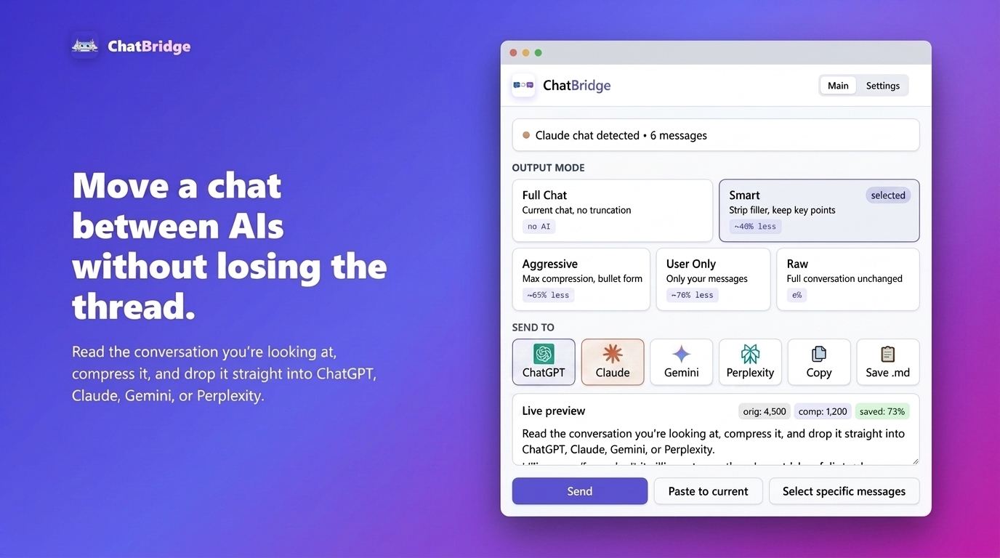
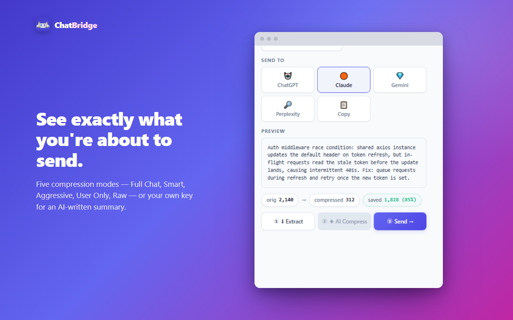
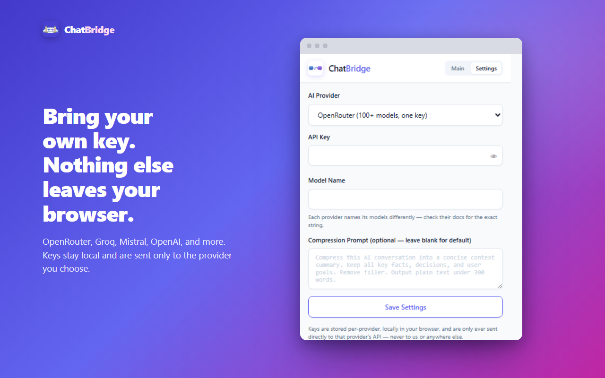

  
  <h1>ChatBridge</h1>
  
<b>Move AI conversations across models with zero context loss and zero token waste.</b>

---

## 📸 Screenshots

| 1. Extract Chat | 2. Compress & Send | 3. BYO-Key Settings |
|:---:|:---:|:---:|
|  |  |  |

---

ChatBridge reads the chat you're currently looking at (Claude, ChatGPT,
Gemini, or Perplexity), compresses it down to what matters, and drops it
straight into the input box of whichever AI you send it to next — or your
clipboard.

## Why

Every long AI conversation eventually needs to move: switching models for a
second opinion, escalating to a more capable one, or just starting fresh
without losing the thread. Copy-pasting loses formatting and wastes tokens on
filler. ChatBridge extracts, compresses, and re-injects it in one click.

## Features

- **Reads the current chat directly from the page** — Claude, ChatGPT,
  Gemini, and Perplexity, with layered fallbacks so it still gets *something*
  usable if a site's layout has changed.
- **Five compression modes**, entirely local (no network call):
  - `Full Chat` — the whole conversation, cleanly formatted, no truncation
  - `Smart` — strips greetings/filler, keeps the substance (~40% smaller)
  - `Aggressive` — bullet-dense, max compression (~65% smaller)
  - `User Only` — just your messages, as a list of questions (~70% smaller)
  - `Raw` — the conversation, verbatim
- **Optional AI-powered compression** — bring your own API key from
  OpenRouter, NVIDIA NIM, Groq, Together AI, Fireworks, DeepInfra, Mistral, or
  OpenAI, and let a model write the summary instead of the local heuristics.
- **One-click send** — opens ChatGPT, Claude, or Gemini in a new tab and
  pastes the result directly into the input box, or copies it to your
  clipboard.
- **Nothing collected.** No accounts, no analytics, no backend server. Keys
  and settings live only in your browser's local storage. See
  [PRIVACY.md](PRIVACY.md) for the full breakdown.

## How to Sideload in Chrome (Step-by-Step)

You can sideload and run ChatBridge in Google Chrome, Brave, or Microsoft Edge in less than a minute:

### Step 1: Download or Locate the Extension Folder
- If downloaded as a ZIP file, extract it to a permanent folder on your computer (e.g., `Documents/chat-bridge-extension`).
- Make sure the folder contains `manifest.json`, `popup.html`, and `background.js`.

### Step 2: Open Extension Management in Chrome
- Open Google Chrome.
- In the address bar, type `chrome://extensions` and press **Enter**  
  *(For Edge, use `edge://extensions`; for Brave, use `brave://extensions`)*.

### Step 3: Enable Developer Mode
- In the top-right corner of the Extensions page, toggle the **Developer mode** switch to **ON**.
- Three new buttons will appear at the top-left: **Load unpacked**, **Pack extension**, and **Update**.

### Step 4: Load the Unpacked Extension
- Click the **Load unpacked** button in the top-left.
- In the file picker dialog, navigate to and select the folder containing `manifest.json` (do not select a ZIP file).
- Click **Select Folder**.
- **ChatBridge** will immediately appear in your list of active extensions!

### Step 5: Pin ChatBridge to Your Toolbar for Easy Access
- Click the **Extensions puzzle icon** (🧩) in the top-right of your Chrome browser toolbar.
- Find **ChatBridge** in the list and click the **Pin icon** (📌).
- The ChatBridge icon will now stay visible next to your address bar for 1-click access.

---

### How to Update / Reload After Code Changes
If you modify or pull new updates to the code:
1. Go back to `chrome://extensions`.
2. Find the **ChatBridge** card.
3. Click the **↻ Reload** button on the bottom-right of the card.
4. Your changes are live immediately!

## Usage

1. Open a chat on Claude, ChatGPT, Gemini, or Perplexity.
2. Click the ChatBridge icon → **Extract**.
3. Pick an output mode and a destination.
4. (Optional) Click **AI Compress** to summarize via your chosen provider
   instead of the local heuristics — add an API key first in **Settings**.
5. Click **Send** — it opens the destination and pastes the result, or copies
   it to your clipboard.

## Supported AI compression providers

| Provider | Get a key |
|---|---|
| OpenRouter | https://openrouter.ai |
| NVIDIA NIM | https://build.nvidia.com |
| Groq | https://console.groq.com/keys |
| Together AI | https://api.together.ai |
| Fireworks AI | https://fireworks.ai |
| DeepInfra | https://deepinfra.com |
| Mistral AI | https://console.mistral.ai |
| OpenAI | https://platform.openai.com/api-keys |

Each key is stored locally per-provider and sent only to that provider's own
API when you click AI Compress — never anywhere else.

## Known limitations

- Extraction relies on each site's current DOM structure. When a site
  redesigns its chat UI, extraction may need a selector update — if a chat
  doesn't extract cleanly, try Copy mode as a fallback, or open an issue.
- Auto-paste uses the browser's standard text-insertion APIs; if a target
  site changes its input element, auto-paste may fail (the extension will
  tell you, and Copy mode always works as a fallback).

## License

MIT
